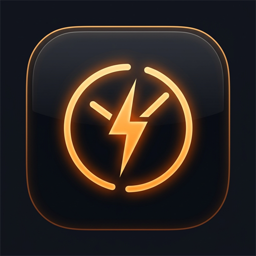
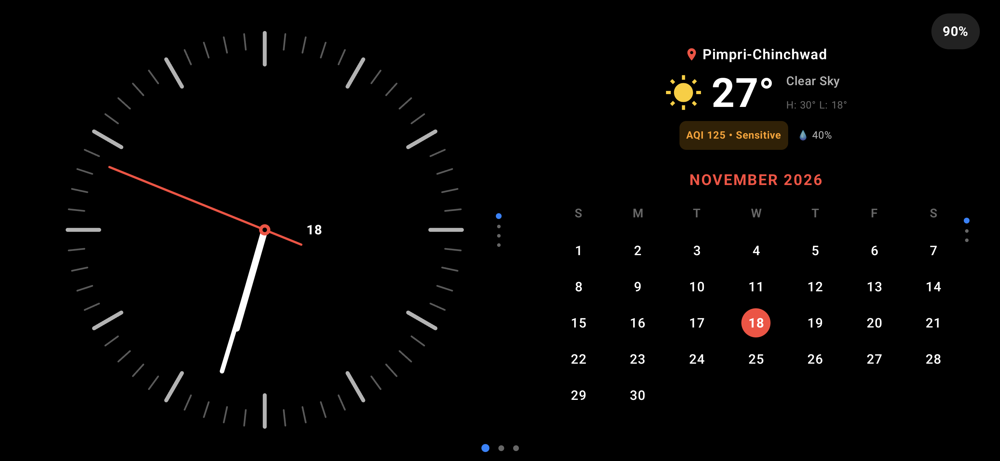

<div align="center">
  
  <h1>StandBy Droid 📱🌙</h1>
  <p><b>Transform your Android phone into an ambient iOS-style StandBy bedside smart display.</b></p>

  [-3DDC84?logo=android&logoColor=white)](https://developer.android.com)
  [](https://kotlinlang.org)
  [](https://developer.android.com/jetpack/compose)
  [](LICENSE)
</div>

---

## 📸 Screen Saver in Action

<div align="center">
  
  <p><i>Live StandBy display running on Samsung Galaxy S24 Ultra: pure AMOLED pitch-black canvas, smooth sweeping analog clock, current location weather with live US AQI, enlarged monthly calendar, and battery level indicator.</i></p>
</div>

---

## 💡 About StandBy Droid

An open-source, high-fidelity replica of **iPhone StandBy mode** for Android devices, built natively with **Kotlin** and **Jetpack Compose (Material 3)**.

When you place your Android phone horizontally on a bedside stand or wireless charger, **StandBy Droid** transforms it into an ambient smart display showing a sweeping analog clock, live local weather with AQI, monthly calendar, battery status, photo slideshows, and retro clock faces on a pure pitch-black AMOLED canvas.

---

## ✨ Features

### 1. 🔲 Dual Smart Stacks (Default Bedside Mode)
- **Left Stack**:
  - **Full Analog Clock**: Pitch-black dial, smooth sweeping second hand, hour markers, and circular date badge at 3 o'clock.
  - *Swipeable* to: **Bold Digital Clock**, **MagSafe Battery Gauge**, or **World Clock**.
- **Right Stack**:
  - **Live Weather**: Current city with location pin (`📍`), weather condition icon, bold temperature, High/Low, humidity, and **Live Air Quality Index (AQI)**.
  - **Monthly Calendar**: Month/year title, weekday headers, and a 5-week date grid with today's date highlighted in an accent badge.
  - *Swipeable* to: **Bedside Music Controller** (with spinning vinyl disc) or **Photo Album**.

### 2. ⚡ Instant Wake-on-Charge While Locked
- When your phone is **locked and screen off**, connecting a charging cable or dropping it onto a wireless charging dock automatically wakes the display (`ACQUIRE_CAUSES_WAKEUP`) and presents StandBy directly over the lockscreen.
- **Auto-Exit on Unplug**: Disconnecting the charger automatically closes StandBy and allows the phone to sleep.

### 3. 🌙 Pure, Distraction-Free Screen Saver
- **No settings gears or floating buttons on the bedside screen**: The screen saver display is completely clean and distraction-free.
- **Top-Right Battery Indicator**: Subtle battery pill (`⚡ [XX]%`) with green lightning bolt indicator while charging.
- **Pitch-Black AMOLED Canvas**: Pure `#000000` background ensures zero backlight bleed and maximum energy efficiency on OLED/AMOLED screens.

### 4. 🎛️ Dedicated In-App Customization Dashboard (Portrait)
Opening the app normally in portrait reveals a comprehensive settings panel:
- **Weather & Location**: Auto-detects current location via IP geolocation or allows entering any custom city.
- **Time Format**: Toggle 12-hour / 24-hour mode and seconds counter.
- **Bedside Night Mode**: Deep monochromatic red glow with 6 selectable color accents (Bedside Red, Warm Amber, Solar Yellow, Mint Green, Ice Blue, Neon Violet).
- **Auto Night Mode**: Uses the device's ambient light sensor to switch into night mode when bedroom lights are turned off.
- **OLED Anti-Burn-In Protection**: Subtle micro-coordinate pixel shifting every 2 minutes.
- **Photo Album Picker**: Select family or vacation memories for the digital photo frame.

### 5. 🖼️ Digital Photo Frame & Big Clocks (Swipe Left / Right)
- **Swipe Left**: Edge-to-edge photo slideshow with a gentle **Ken Burns slow pan/zoom** animation.
- **Swipe Right**: 5 full-screen artistic clock designs:
  1. **Bold Digital Clock**: Screen-filling numerals with date and battery status.
  2. **Retro Flip Clock**: Split-flap mechanical card animation.
  3. **Solar Arc**: Tracks the sun and moon path across the horizon.
  4. **Roman Analog**: Luxury dial with Roman numerals on pitch-black background.
  5. **Neon Glow**: Vibrant glowing neon tubes.

### 6. 💤 Official Android Native Screen Saver (`DreamService`)
- Fully integrated with Android's built-in `DreamService` framework.
- Zero background services, zero background polling, and zero battery drain when not charging.

---

## 📋 Prerequisites & Compatibility

- **Android Version**: Android 8.0 (Oreo / API 26) or higher.
- **Hardware**: Any Android smartphone or tablet with landscape support (optimized for AMOLED displays like Samsung Galaxy, Google Pixel, Xiaomi, OnePlus, Motorola).
- **Permissions**:
  - `INTERNET`: For live weather & AQI queries (free Open-Meteo API, no API key needed).
  - `WAKE_LOCK`: To keep the display alive on the bedside stand.
  - `SYSTEM_ALERT_WINDOW` ("Appear on top"): Required for instant wake-on-charge while the phone is locked.

---

## 📲 How to Install & Configure

### Option 1: Quick Install via ADB
If you have a computer with ADB connected to your phone:

```powershell
# 1. Install the APK
adb install -r StandByDroid.apk

# 2. Grant "Appear on top" permission (for instant wake-on-charge while locked)
adb shell appops set com.droidstandby.app SYSTEM_ALERT_WINDOW allow

# 3. Grant notification permission (Android 13+)
adb shell pm grant com.droidstandby.app android.permission.POST_NOTIFICATIONS
```

### Option 2: Manual Installation on Device
1. Transfer `StandByDroid.apk` to your phone and tap to install.
2. Open **StandBy Droid** in portrait orientation.
3. Grant **"Appear on top" / "Draw over other apps"** in your phone's settings:
   - **Samsung (One UI)**: Settings > Apps > Special access > Appear on top > Enable **StandBy Droid**.
   - **Google Pixel**: Settings > Apps > Special app access > Display over other apps > Enable **StandBy Droid**.
   - **Xiaomi / POCO (HyperOS / MIUI)**: Settings > Apps > Manage apps > StandBy Droid > Other permissions > Enable "Display pop-up windows while running in the background" & "Show on Lock screen".
   - **OnePlus / OPPO / Realme (OxygenOS / ColorOS)**: Settings > Apps > Special app access > Display over other apps > Enable **StandBy Droid**.
4. Configure your preferred settings in the app and tap **Save & Apply Settings**.

---

## ⚙️ Enabling Android System Screen Saver (Optional)

To also use it as Android's official system screen saver:
1. Open your phone's **Settings > Display > Screen saver** (or Daydream).
2. Select **StandBy Screen Saver**.
3. Set **When to start** to **"While charging"** or **"Either"**.

---

## 🛠️ Building from Source

### Requirements
- **JDK**: Java 17 or higher.
- **Android SDK**: Build tools 35.0.0, compileSdk 35, minSdk 26.
- **Gradle**: 8.9+ or wrapper provided.

### Build Steps
```bash
# Clone the repository
git clone https://github.com/KoolBhushan/StandByDroid.git
cd StandByDroid

# Build debug APK
./gradlew assembleDebug

# Output APK location:
# app/build/outputs/apk/debug/app-debug.apk
```

---

## 🏗️ Architecture & Technologies

- **UI Framework**: 100% Jetpack Compose with Material 3.
- **Navigation & Gestures**: `HorizontalPager` for screen modes and `VerticalPager` for smart stacks.
- **Graphics & Clocks**: Jetpack Compose `Canvas` with hardware-accelerated drawing for 60/120 FPS sweeping second hands and analog dial math.
- **Weather API**: [Open-Meteo](https://open-meteo.com) weather forecast & geocoding (no API key required).
- **Air Quality API**: [Open-Meteo Air Quality](https://air-quality-api.open-meteo.com) for real-time US AQI & PM2.5 tracking.
- **State & Preferences**: `SharedPreferences` with reactive Compose state observation.
- **Power Lifecycle**: `PowerConnectionReceiver` listening to `ACTION_POWER_CONNECTED` / `ACTION_POWER_DISCONNECTED` with lockscreen bypass (`setShowWhenLocked`, `setTurnScreenOn`).
- **Screen Saver API**: Native AOSP `DreamService` integration.

---

## 👨‍💻 Author & Developer

**Bhushan Kamble**
- **GitHub**: [@KoolBhushan](https://github.com/KoolBhushan)
- **Repository**: [https://github.com/KoolBhushan/StandByDroid](https://github.com/KoolBhushan/StandByDroid)

---

## 📄 License

This project is licensed under the [MIT License](LICENSE).
Feel free to fork, customize, and contribute!
